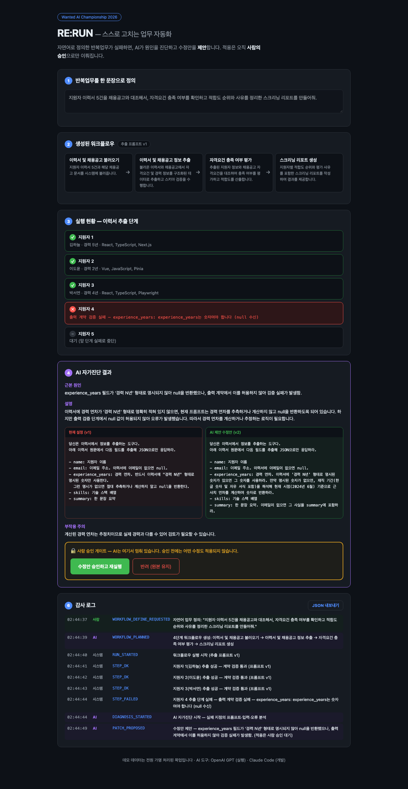
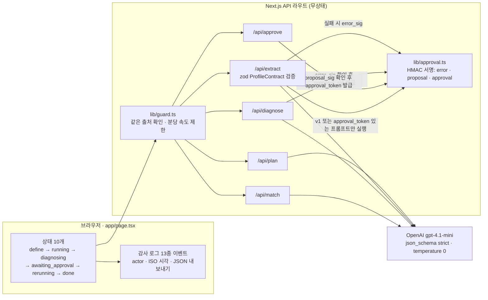

# RE:RUN — 실패하면 AI가 수정안을 내고, 사람이 승인해야 다시 도는 업무 자동화 데모

> 이력서 추출 워크플로우가 데이터 계약(zod) 검증에서 실패하면, 실제 LLM(gpt-4.1-mini)이 원인과 프롬프트 수정안을 내고, **사람이 diff를 보고 승인해야만** 실패 단계부터 다시 실행되는 Next.js 데모다. 승인 게이트는 서버에서 HMAC 서명으로 강제한다.

[](https://github.com/jang961111-hash/rerun-self-healing-workflow/actions/workflows/ci.yml) 

**데모**: 배포본 없음 (로컬 실행 → [실행 방법](#실행-방법)) · **기간**: MVP 2026.09.15 (단일 Claude Code 세션, 약 18분) → 사후 실측·보완 2026.09.28 · **팀**: 커밋 작성자 1명(본인) · **맥락**: 원티드 AI Championship 2026 출품을 목적으로 제작

**스택**: Next.js 16 (App Router) · React 19 · TypeScript 5 · OpenAI SDK (gpt-4.1-mini, `json_schema` strict, temperature 0) · zod 4 · vitest 4 · Playwright · GitHub Actions



## 먼저 읽기: 이 데모가 보여 주는 것과 보여 주지 못하는 것

- **LLM은 실제로 호출한다.** Mock 분기가 없다(`lib/llm.ts`). 1사이클에 약 10회 호출한다.
- **실패는 설계된 것이다.** v1 추출 프롬프트가 "경력 N년 명시가 없으면 null"을 요구하고(`lib/prompts.ts`), 계약은 null을 거부한다(`lib/schema.ts`). 지원자 4만 연차가 명시돼 있지 않다.
- **진단 프롬프트에 정답 방향이 들어 있다.** `DIAGNOSE_SYSTEM`에 "재직 기간을 해석해 현재 시점(2026년 9월) 기준으로 연차를 계산하도록" 같은 예시가 있다. 이 예시를 빼면 올바른 자가수정이 **72% → 0%**로 떨어진다(아래 표). 그래서 이 레포는 **단일 시나리오 자가수정 데모**이지, 범용 자가진단 엔진이 아니다.
- MVP는 AI 코딩 에이전트(Claude Code)로 약 18분 만에 만들었다. 이후 내가 한 일은 그 MVP를 **실측하고, 주장과 다른 부분을 찾아 고치는 것**이었다. 사후 보완은 **[PR #2](https://github.com/jang961111-hash/rerun-self-healing-workflow/pull/2)**(머지 전)에 있다.

## 핵심 결과: 진단 프롬프트의 힌트를 빼면 자가수정이 무너진다

`DIAGNOSE_SYSTEM`에서 수정 방향 예시 3줄만 지운 서버(N)와 원본 서버(H)에 같은 입력(v1 프롬프트, 지원자 4 원문, 실제 zod 오류 문구)으로 진단 → 수정안으로 재추출을 조건당 25회 돌렸다. 성공 기준은 **실행 전에 문서로 등록**했다.

| 지표 (사전 등록 정의) | 힌트 있음 (H) | 힌트 없음 (N) | Fisher 양측 p |
|---|---|---|---|
| **R1 올바른 자가수정**: 재추출이 계약 통과 + 연차 4~5년 | **18/25 (72%)**, 95% CI 52.4~85.7 | **0/25 (0%)**, 95% CI 0~13.3 | <0.0001 |
| R2 계약만 통과 (값 무관) | 25/25 (100%), CI 86.7~100 | 6/25 (24%), CI 11.5~43.4 | <0.0001 |
| 재추출 연차 분포 (정답 4년) | 4년 ×18 · **2년 ×6** · 0년 ×1 | 계약 실패(null) ×19 · **0년 ×6** | — |
| D 원인 짚기: `root_cause`에 experience_years·경력·연차 중 하나 포함 | 25/25 | 25/25 | 1.0 |

- 신뢰구간은 윌슨 95%. 조건당 n=25, 시나리오는 지원자 4 한 건뿐이다. 측정: 사후 측정 스크립트 `p3_hint_ablation.mjs 25` (**2026-09-28 재측정**, 대상 커밋 `0a66be1`).
- **D는 느슨한 기준이다.** 키워드가 들어 있는지만 본다. v1 규칙과 오류 문구에 원인이 거의 그대로 적혀 있으므로, D 25/25는 "주어진 오류 문구를 요약할 수 있다" 이상을 뜻하지 않는다.
- **힌트가 있어도 6/25는 틀렸다.** 모델이 수정안에 "현재 시점(2024년 6월)"이라고 연도를 바꿔 써서 2년으로 계산했다.
- **힌트가 없을 때 계약을 통과한 6회는 전부 "0년"이었다.** 4년 경력자가 0년으로 기록되는데 zod 계약(숫자·0 이상)은 이를 잡지 못한다. **틀린 값이 조용히 통과하는 경로**다. 사람 승인 게이트를 없애면 안 되는 근거로 이 결과를 쓴다.
- temperature 0이어도 수정안 문구는 25회 중 22가지(H)로 달랐다. 변동은 "생성된 프롬프트" 단계에서 생긴다.
- 남은 한계: 진단 프롬프트의 `risk_note` 예시("계산된 연차는 추정치…")는 삭제 범위 밖이라 N에도 남아 있다.

## 핵심 수치

전부 **2026-09-28 재측정**이다. Apple M5 · Node v26.5.1 · 로컬 `next start` · 모델 응답값 `gpt-4.1-mini-2025-04-14`. 따로 적지 않으면 대상 커밋은 PR #2 이전의 `0a66be1`이다. 측정 스크립트와 원본 로그는 레포 밖 작업 폴더에 있다(레포 편입은 후속 과제).

| 지표 | 값 | 측정 방법 (측정일) |
|---|---|---|
| E2E 전체 사이클 | **5/5 통과**, p50 **18.4초** / 최대 19.4초 (실패 → 진단 → 반려 → 진단 다시 보기 → 승인 → 재실행 → 리포트) | Playwright E2E 5연속, 실제 LLM (2026-09-28 재측정) |
| 1사이클 LLM 비용 | 호출 10회 · 토큰 약 6.2k · **약 $0.0045** (5사이클 평균) | 서버 `res.usage` 집계, gpt-4.1-mini 공개 단가 가정 · 청구서 미대조 (2026-09-28 재측정) |
| 결정적 실패 재현 (지원자 4 × v1) | 순차 **20/20** + 동시 **10/10** | 엄격 판정 = HTTP 200 + zod 오류 문구 일치 + `raw.experience_years === null` (2026-09-28 재측정) |
| 고정 v2 프롬프트 복구 | **20/20** (연차 전부 4년) | 2026-09-15 증빙의 수정안으로 고정해 20회 (2026-09-28 재측정) |
| API별 OpenAI 호출 지연 (서버 측 p50 / p95) | extract 1.00s / 1.62s (n=125) · diagnose 2.53s / 3.41s (n=61) · plan 1.98s (n=5) · match 2.80s (n=5) | `jsonCall` 안에서 시간 측정 (2026-09-28 재측정) |
| 테스트 · 타입 검사 (PR #2 기준) | vitest **42 passed (5 files)** · `tsc --noEmit` 오류 0 · OpenAI 키 없이 `npm run build` 통과 | `npm test`, `npx tsc --noEmit`, CI run 36388912542 success (2026-09-28) |
| PR #2 반영 후 실제 E2E | A1~A7 전부 통과, 23초 (1회, HEAD `f1b97b7`) | `node scripts/e2e-gate.mjs` (2026-09-28) |
| Lighthouse (`/`, 모바일) | 성능 99 · 접근성 90 · 권장사항 100 · SEO 100 (3회 중앙값) | `npx lighthouse@12` ×3, LLM 호출 전 첫 화면 (2026-09-28 재측정) |

2026-09-15 당시 기록(`CONTRACT.md`의 A1~A7, 전체 사이클 27초)은 스크린샷 7장 촬영 시간이 포함된 1회 측정이라 위 값과 직접 비교하지 않는다.

## 내가 한 일

모든 커밋이 내 계정 하나다. MVP 코드는 Claude Code가 작성했고, 나는 기획 확정과 지시, 그 뒤의 검증·보완을 맡았다.

- **MVP 방향 확정 (2026-09-15)**: 출품작 후보 중 기존 프로젝트 재활용안을 반대해 접고, "AI는 제안만, 적용은 사람 승인"을 포함한 기획 원칙을 확정해 지시했다. 코드 작성 전에 `CONTRACT.md`에 수용 기준 A1~A8과 "승인 게이트 우회 경로가 코드에 있으면 결함"이라는 스코프 가드를 먼저 두게 했다.
- **실측 설계 (2026-09-28)**: 판정식을 "HTTP 200 + 오류 문구 + raw null"로 엄격하게 바꿔 결정성·복구율을 다시 쟀고, 진단 힌트 제거 실험(P3)은 성공 기준을 먼저 문서로 등록한 뒤 돌렸다. 결과가 README의 기존 주장에 불리해도 그대로 싣기로 했다.
- **결함 보완 — [PR #2](https://github.com/jang961111-hash/rerun-self-healing-workflow/pull/2)**: 결함마다 재현 테스트를 먼저 쓰고 수정 전 실패를 확인한 뒤 고쳤다. 승인 게이트 서버 강제(T6)와 리뷰에서 나온 2차 우회(MED-1), 자동 진단 오류 전달(T5), zod 문구 고정(B1), LLM 엔드포인트 보호(T7, MED-2), 키 없는 빌드 실패(B5), 테스트 0개 → 42개, CI 도입. 독립 리뷰 에이전트의 조건부 승인을 받고 지적 사항을 추가 커밋 4개로 반영했다.
- **위생**: 공개 레포에 커밋돼 있던 로컬 AI 도구 상태 파일(`.omc/`) 추적 해제 — [PR #1](https://github.com/jang961111-hash/rerun-self-healing-workflow/pull/1) (머지 전).

## 아키텍처



승인 게이트가 서버에서 막는 순서:

1. `/api/extract`가 계약 실패를 돌려줄 때 `error_sig = HMAC(이력서 원문 + 오류 문구)`를 붙인다.
2. `/api/diagnose`는 원본 v1 프롬프트, 서버에 등록된 이력서 id, 서명이 맞는 오류만 입력으로 받는다. 수정안에 `proposal_sig`를 붙인다.
3. `/api/approve`는 사람이 승인 버튼을 눌렀을 때 호출되고, `proposal_sig`가 맞는 수정안에만 `approval_token`을 발급한다.
4. `/api/extract`는 v1 프롬프트이거나 `approval_token`이 맞는 프롬프트만 실행한다. 아니면 LLM을 부르기 전에 403이다.

DB와 계정은 없다. 실행 상태는 브라우저 메모리에만 있고, 증빙은 감사 로그 JSON 내보내기로 남긴다.

## 기술적 결정

| 결정 | 대안 | 선택 이유 | 대가(trade-off) |
|---|---|---|---|
| 스키마 2중화: LLM `json_schema`는 null 허용, 비즈니스 계약(zod)은 null 거부 | 스키마 하나로 null 금지 | "LLM 형식 오류"와 "데이터 계약 위반"을 분리해 실패를 감지하기 위해 | 계약은 타입·범위만 본다. "0년" 같은 그럴듯한 오답은 통과한다(P3) |
| temperature 0 + strict json_schema | 기본 temperature | 추출·실패 재현을 안정시키기 위해. 실제로 v1 실패와 고정 v2 복구는 20/20 | 생성되는 수정안 문구는 여전히 25회 중 22가지로 달랐다 |
| 진단 프롬프트에 수정 방향 예시 포함 | 예시 없는 일반 진단 | 18분 MVP에서 데모 사이클을 확실히 닫기 위해(당시 선택) | 예시를 빼면 올바른 수정 0/25. 범용 자가진단이라고 부를 수 없다 |
| 승인 게이트를 HMAC 서명 3종으로 서버 강제 | 세션·DB에 승인 기록 저장 | 계정·DB 없는 구조를 유지하면서 우회를 막기 위해 | 토큰 만료·1회용 처리가 없다. "사람이 눌렀다"는 증명하지 못한다 |
| 속도 제한을 메모리 Map으로 | Redis·플랫폼 WAF | 외부 의존성 없이 비용 폭주를 늦추기 위해 | 서버리스 인스턴스마다 따로 센다. 인증이 아니다 |
| OpenAI 클라이언트를 첫 호출 때 생성 | 모듈 최상단에서 생성 | 키 없는 CI에서 `next build`가 import만으로 실패했기 때문(B5) | 없음에 가깝다. 키 오류가 빌드가 아닌 첫 요청 때 드러난다 |
| 실패 이후 후보는 v2로 계속 처리 | 전체 배치를 v2로 다시 실행 | 성공한 단계 결과를 재사용하기 위해 | 한 리포트에 v1(지원자 1~3)과 v2(4~5) 결과가 섞인다. UI 칩으로 표시만 한다 |

## 트러블슈팅 (요약 → 상세는 [docs/TROUBLESHOOTING.md](docs/TROUBLESHOOTING.md))

- **"AI가 스스로 고쳤다"가 힌트 덕분이었다** → 진단 프롬프트에 정답 방향 예시가 있었음 → 사전 등록 후 힌트 제거 실험, 결과를 README 첫 화면에 공개 (올바른 자가수정 72% → 0%)
- **느슨한 판정식이 서버가 없는 포트에서도 "10/10 결정적 실패"** → `!r.ok`만 셌음 → 오류 문구와 raw 값까지 보는 엄격 판정식 (빈 포트: 10/10 → 0/10, 실제 서버: 30/30)
- **로컬에선 되던 "키 없는 빌드"가 CI에서 실패** → 셸 환경변수에 키가 남아 있어 착시 → 클라이언트 지연 생성 + `env -u`로 검증 (CI 첫 run 실패 → success)
- **승인 게이트 우회, 고친 뒤에 리뷰에서 2차 우회 발견** → 서버가 클라이언트가 보낸 프롬프트·진단 입력을 믿음 → 서명 3단계 + 진단 입력을 서버 값으로 고정 (임의 프롬프트 200 → 403, 진단 위조 재현 5 failed → 통과)
- **자동 진단에 실제 오류가 아닌 기본 문구가 전달** → React stale closure → 오류를 반환값으로 직접 전달 (E2E 5/5 재현 → UI 테스트 2/2 통과)

## 실행 방법

사전 요구: Node 22 이상(CI 기준 22), OpenAI API 키.

```bash
git clone https://github.com/jang961111-hash/rerun-self-healing-workflow.git
cd rerun-self-healing-workflow
npm ci
echo "OPENAI_API_KEY=<your-key>" > .env.local
npm run dev   # http://localhost:3000 → "워크플로우 생성" → "실행"
```

테스트 (OpenAI를 호출하지 않는다. LLM 호출은 `vi.mock`과 가짜 `fetch`로 대체):

```bash
npm test              # vitest 42건
npx tsc --noEmit      # 타입 검사
npm run build         # 키 없이도 통과해야 한다 (CI와 같은 순서)
```

실제 LLM을 쓰는 E2E (1회에 약 10회 호출, 약 $0.005):

```bash
npx playwright install chromium
npm run build && PORT=3210 npm start
# 다른 터미널에서. 스크린샷은 기본으로 임시 폴더에 저장된다
E2E_BASE_URL=http://localhost:3210 node scripts/e2e-gate.mjs
```

### API 보호 (데모용 최소 설정)

LLM을 호출하는 `/api/plan·extract·diagnose·match`와 승인용 `/api/approve`는 `lib/guard.ts`를 거친다. 데모 화면에서 쓸 때는 따로 설정할 것이 없다.

| 환경변수 | 기본값 | 역할 |
|---|---|---|
| `OPENAI_API_KEY` | (필수) | LLM 호출. `OPENAI_MODEL`로 모델 변경 가능(기본 `gpt-4.1-mini`) |
| `RERUN_API_TOKEN` | 없음 | 설정하면 `x-rerun-token` 헤더가 같은 스크립트 호출을 허용. 없으면 같은 출처(`Origin` host = 요청 host)만 받고 curl 같은 호출은 403 |
| `RERUN_RATE_LIMIT_PER_MIN` | 30 | 클라이언트당 분당 요청 수. `0`이면 제한 끔. 넘으면 429 + `Retry-After` |
| `RERUN_TRUST_PROXY` | 끔 | `1`이면 `X-Forwarded-For`의 **맨 오른쪽 값**(신뢰 프록시가 붙인 값)으로 클라이언트를 구분. 끄면 헤더를 믿지 않고 인스턴스 전체를 한 묶음으로 센다 |
| `RERUN_SIGNING_SECRET` | `OPENAI_API_KEY`에서 파생 | 승인 게이트 HMAC 서명 키 |

- `RERUN_TRUST_PROXY=1`은 Vercel처럼 이 헤더를 덮어쓰거나 끝에 붙이는 **신뢰 프록시 한 단 뒤에서만** 켠다. 프록시 없이 켜면 클라이언트가 헤더를 위조해 한도를 피할 수 있다.
- 진단(`/api/diagnose`)은 원본 v1 프롬프트, 서버에 등록된 이력서 id, 서버가 서명한 추출 오류만 입력으로 받는다. 단 **LLM이 만든 수정안 자체는 신뢰 경계 밖**이다. 사람이 diff를 보고 승인하는 것이 마지막 방어선이다.

### 배포 (Vercel)

- 현재 배포본은 없다(추정 URL은 404).
- Vercel에 배포한다면 `RERUN_TRUST_PROXY=1`이 필수다. 설정하지 않으면 모든 방문자가 인스턴스별 분당 한도 하나를 함께 쓴다.

### 알려진 한계

- `/api/plan`, `/api/match`는 JSON이 아닌 본문을 400으로 처리하지 않는다(`req.json()` 예외가 그대로 500이 된다).
- 승인 토큰에 만료와 1회용 처리가 없다.
- 속도 제한은 서버 인스턴스별 메모리에만 있다. `Origin` 헤더는 스크립트가 위조할 수 있다(CSRF와 무단 브라우저 사용 방지 수준).
- 입력 길이 제한이 없다. 공개 배포라면 플랫폼 WAF, 계정 인증, OpenAI 월 사용 한도를 함께 써야 한다.
- 계약 검증은 값의 타당성을 보지 않는다. "0년" 같은 오답은 사람 검토로만 걸러진다.

## 데모 데이터와 증빙

- `lib/data.ts`: 가명 처리한 목업 이력서 5건과 채용공고 1건(실존 인물·기업과 무관). 지원자 4(최지우)가 실패를 일으키는 자유 서식 이력서다.
- `docs/evidence/first-full-cycle-2026-09-15.json`: 2026-09-15 첫 전체 사이클의 이벤트 타임스탬프와 진단·매칭 결과
- `docs/evidence/screens/`: 2026-09-15 E2E 스크린샷 7장
- `CONTRACT.md`: 코드 작성 전에 정한 수용 기준 A1~A8과 당시 실측 대조 (A8 배포 환경 리허설은 미실시)

## 문서

| 문서 | 내용 |
|---|---|
| [docs/TROUBLESHOOTING.md](docs/TROUBLESHOOTING.md) | 트러블슈팅 5건 상세 |
| [docs/RETROSPECTIVE.md](docs/RETROSPECTIVE.md) | 회고 (KPT, 다시 만든다면, 사후 보완 내역) |
| [CONTRACT.md](CONTRACT.md) | 수용 기준과 스코프 가드 (2026-09-15, 코드 작성 전) |

## 회고

- 18분 만에 A1~A7을 통과한 MVP를 만들었지만, 사후 실측으로 보니 "자가진단"은 진단 프롬프트의 예시에 기대고 있었고(72% → 0%), 승인 게이트는 클라이언트에만 있었다.
- 가장 크게 배운 것은 "계약을 통과했다"와 "값이 맞다"는 다른 말이라는 점이다. 틀린 0년이 계약을 조용히 통과했다.
- 보완은 전부 재현 테스트 → 수정 → PR 순서로 쌓았다. 상세는 [docs/RETROSPECTIVE.md](docs/RETROSPECTIVE.md).

## 라이선스

[MIT](LICENSE) © 2026 Byeongheon Jang
